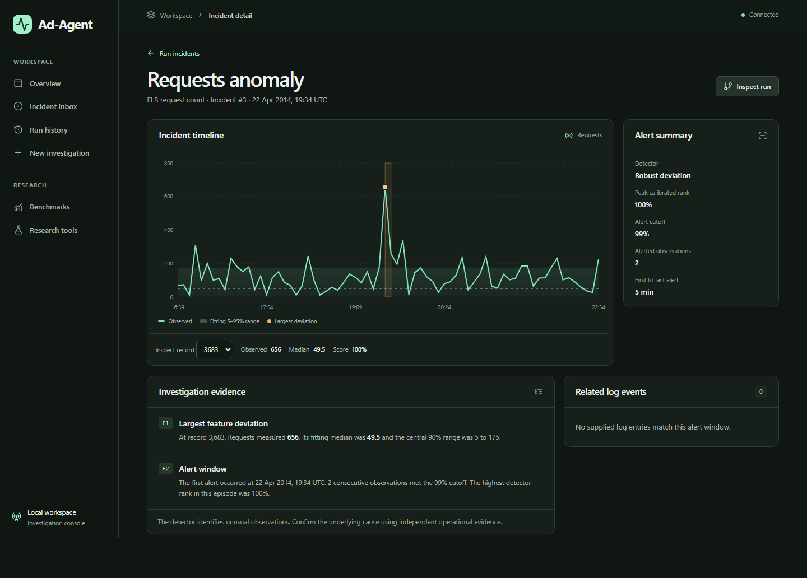

# Ad-Agent

Ad-Agent investigates anomalies in service metrics and numeric tables. Open a detected incident to see the observed signal, its expected range, and the records that triggered the alert. Each investigation runs through the seven stages of the AD-AGENT LangGraph and saves its trace and checkpoints in SQLite.

## Repository guide

| Folder | What you’ll find |
| --- | --- |
| [backend/](backend/) | Flask API, seven-stage LangGraph, and numeric workbench. The [backend guide](backend/README.md) covers entry points, workers, and storage. |
| [backend/investigations/](backend/investigations/) | CSV validation, detectors, SQLite queue, worker, and reproducible benchmark. |
| [backend/tests/](backend/tests/) | API, detector, worker recovery, and local-model tests. |
| [frontend/](frontend/) | React and TypeScript console. The [frontend guide](frontend/README.md) covers development and browser tests. |
| [data/](data/) | Sample inputs, the benchmark report and its source files, and the archived model artifact. |
| [docs/](docs/) | [Console screenshots](docs/screenshots/), detector references, and the [original research workflow and citation](docs/research.md). |

## Open the investigation console

On Windows, double-click **Start-AdAgent.cmd** in the project folder. For a fresh checkout, install Python 3.11 and Node.js with npm first. The launcher prepares the environment, builds the frontend when its sources or configuration are newer than the last build, and opens the [local console](http://127.0.0.1:8000/). It also builds the frontend on first use.

Choose **Explore incident** on the overview to investigate the load-balancer sample. The largest excursion was 656 requests against a fitting median of 49.5. Select **Inspect run** to see the seven agent decisions and compare the detectors. For your own data, choose **New investigation**, upload an ordered CSV, and confirm its numeric features, optional timestamp, and optional binary label.



To build manually, activate a Python 3.11 virtual environment and run these commands from the project root. Rebuild the frontend after changing its source.

```sh
python -m pip install -r backend/requirements-console.txt
cd frontend
npm ci
npm run build
cd ..
python backend/server.py --open
```

## Reproduce the investigation results

The investigation uses four slices in file order. The first 40% fits the detectors, the next 20% calibrates their scores, the next 20% selects the detector and cutoff, and the last 20% measures performance. When validation contains both label classes, the selection criterion is incident F1. Otherwise the workflow uses the daily seasonal baseline when eligible, or robust deviation, at the 99th percentile.

| Held-out NAB trace | Selected detector | Labeled windows caught | Unmatched alert groups |
| --- | --- | ---: | ---: |
| EC2 CPU utilization | Daily seasonal median | 1 of 2 | 4 |
| ELB request count | Robust deviation | 1 of 1 | 8 |
| Exchange 4 CPM | Robust deviation | 1 of 1 | 5 |

**Benchmarks** shows every candidate and its validation cutoffs. The verification command reruns the seven-stage graph on the bundled traces and compares the full result with the [recorded report](data/benchmarks/report.json). The [source manifest](data/benchmarks/sources.json) lists the input files and label windows.

```sh
cd backend
python -m unittest discover -s tests -p "test_*.py"
python -m investigations.benchmark --verify
```

Investigations run locally on CPU. With Ollama running locally and `llama3.2:3b` installed, **Request a local-model brief** adds an evidence review to the incident with the largest scaled deviation. From `backend/`, run `python -m investigations.briefs` to audit its numeric claims against the three fixed examples.

## Standalone numeric workbench

Under **Research tools**, open **Numeric workbench** and choose **Run sensor demo** to try the older two-detector analysis on 400 synthetic readings with six injected spikes. This tool uses its own three-way split.

| Stage | Data in file order | Operation |
| --- | --- | --- |
| Fit | First 50% | Fit Isolation Forest and estimate per-feature medians and scales. |
| Calibrate | Next 25% | Build a reference score distribution for each detector. |
| Evaluate | Final 25% | Convert each detector score to the fraction of calibration scores below it and average the two ranks. |

The selected cutoff applies to the scores. For example, a 95% cutoff flags an ensemble rank of at least 0.95. The percentage of flagged evaluation records varies with the data. Ranks measure unusualness and are not probabilities of a fault.

Upload 100–10,000 records with 1–32 finite numeric features and a header (2 MB maximum). Arrange rows in observation order and place representative baseline data first. Optional lowercase `timestamp` and `id` columns are metadata. An optional `label` column uses 1 for anomalies and 0 for normal observations. Labels are used only for evaluation. Missing feature values are rejected with a line number.

The report compares alert counts and, for labeled data, confusion counts. ROC AUC and average precision require both classes in the evaluation slice. For each of the 20 highest-ranked records the console shows the largest scaled feature deviation and its reference median. This evidence describes the observation and does not establish a cause.

## Original research workflow

Ad-Agent builds on the AD-AGENT framework by Yang et al. The provider-backed, code-generating workflow is experimental and requires a trusted local research session. Its advanced configuration controls and full end-to-end verification are pending. Setup instructions, upstream results, and the paper citation are in the [research guide](docs/research.md).
