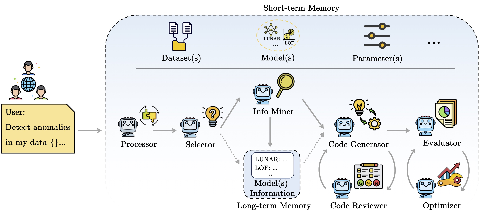
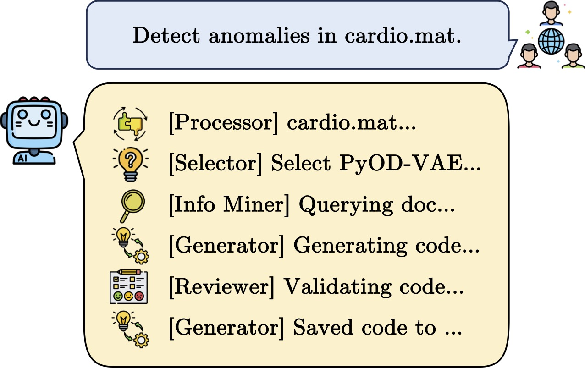
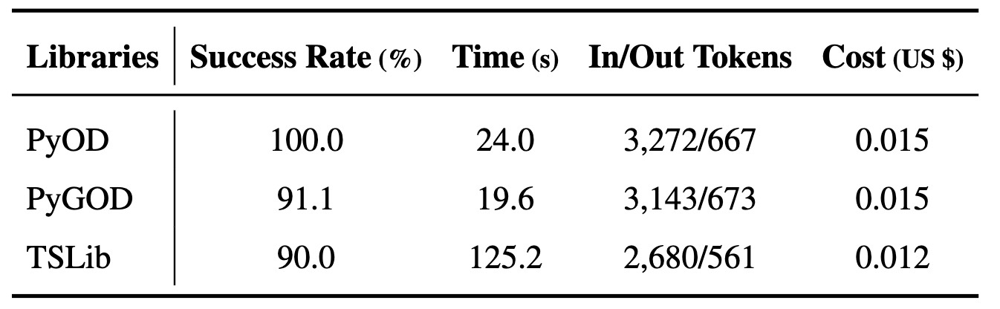
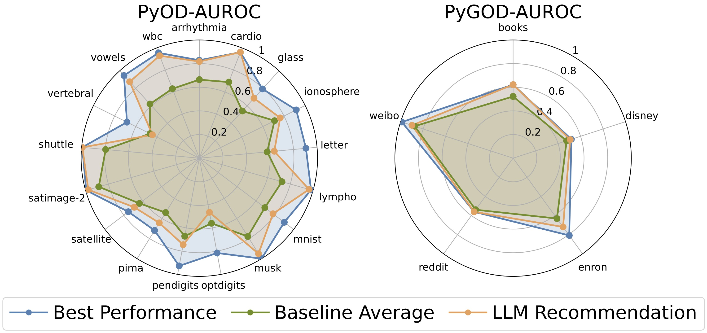

# Ad-Agent

Ad-Agent investigates anomalies in service metrics and numeric tables. Open a detected incident to see the observed signal, its expected range, and the records that triggered the alert. Each investigation runs through the seven stages of the AD-AGENT LangGraph and saves its trace and checkpoints in SQLite.

## Open the investigation console

On Windows, double-click **Start-AdAgent.cmd** in the project folder. For a fresh checkout, install Python 3.11 and Node.js with npm first. The launcher prepares the environment, builds the frontend when its sources or configuration are newer than the last build, and opens the [local console](http://127.0.0.1:8000/). It also builds the frontend on first use.

Choose **Explore incident** on the overview to investigate the load-balancer sample. The largest excursion was 656 requests against a fitting median of 49.5. Select **Inspect run** to see the seven agent decisions and compare the detectors. For your own data, choose **New investigation**, upload an ordered CSV, and confirm its numeric features, optional timestamp, and optional binary label.

To build manually, activate a Python 3.11 virtual environment and run these commands from the project root. Rebuild the frontend after changing its source.

```sh
python -m pip install -r requirements-console.txt
cd "new frontend"
npm ci
npm run build
cd ..
python server.py --open
```

## Reproduce the investigation results

The investigation uses four slices in file order. The first 40% fits the detectors, the next 20% calibrates their scores, the next 20% selects the detector and cutoff, and the last 20% measures performance. When validation contains both label classes, the selection criterion is incident F1. Otherwise the workflow uses the daily seasonal baseline when eligible, or robust deviation, at the 99th percentile.

| Held-out NAB trace | Selected detector | Labeled windows caught | Unmatched alert groups |
| --- | --- | ---: | ---: |
| EC2 CPU utilization | Daily seasonal median | 1 of 2 | 4 |
| ELB request count | Robust deviation | 1 of 1 | 8 |
| Exchange 4 CPM | Robust deviation | 1 of 1 | 5 |

**Benchmarks** shows every candidate and its validation cutoffs. The verification command reruns the seven-stage graph on the bundled traces and compares the full result with the [recorded report](data/benchmarks/report.json). The [source manifest](data/benchmarks/sources.json) lists the input files and label windows.

```sh
python -m investigations.benchmark --verify
python -m unittest discover -p "test_*.py"
```

Investigations run locally on CPU. With Ollama running locally and `llama3.2:3b` installed, **Request a local-model brief** adds an evidence review to the incident with the largest scaled deviation. Run `python -m investigations.briefs` to audit its numeric claims against the three fixed examples.

## Standalone numeric workbench

Under **Research tools**, open **Numeric workbench** and choose **Run sensor demo** to try the older two-detector analysis on 400 synthetic readings with six injected spikes. This tool uses its own three-way split.

| Stage | Data in file order | Operation |
| --- | --- | --- |
| Fit | First 50% | Fit Isolation Forest and estimate per-feature medians and scales. |
| Calibrate | Next 25% | Build a reference score distribution for each detector. |
| Evaluate | Final 25% | Convert each detector score to the fraction of calibration scores below it and average the two ranks. |

The selected cutoff applies to the scores. For example, a 95% cutoff flags an ensemble rank of at least 0.95. The percentage of flagged evaluation records varies with the data. Ranks measure unusualness and are not probabilities of a fault.

Upload 100–10,000 records with 1–32 finite numeric features and a header (2 MB maximum). Arrange rows in observation order and place representative baseline data first. Optional lowercase `timestamp` and `id` columns are metadata. An optional `label` column uses 1 for anomalies and 0 for normal observations. Labels are used only for evaluation. Missing feature values are rejected with a line number.

The report compares alert counts and, for labeled data, confusion counts. ROC AUC and average precision require both classes in the evaluation slice. For each of the 20 highest-ranked records the console shows the largest scaled feature deviation and its reference median. This evidence describes the observation and does not establish a cause.

### Research workflow and attribution

The overview, citation, and upstream setup notes below describe the original research framework by Yang et al. Running its code-generating workflow requires the additional dependencies in `requirements.txt`, provider credentials, and model or dataset assets. The local console enables research execution only when started with `AD_AGENT_TRUSTED_RESEARCH=1`. Some research assets in a ZIP checkout may be Git LFS pointers.

In this release, the legacy research form submits the command and dataset paths. Its advanced configuration controls are still under development. The end-to-end checks cover the local investigation console. Full verification of the provider-backed code-generation workflow is pending.

**AD-AGENT** is an LLM‑driven multi-agent anomaly detection platform designed to support the full lifecycle of real-world anomaly detection—from data preprocessing and model selection to detection, explanation, and evaluation. It integrates classical and graph-based AD algorithms with LLM-powered modules for enhanced usability, privacy, and adaptability.



> 🔍 One platform. Multiple agents. All your anomaly detection workflows—automated, explainable, and secure.

---


## 📝 Citation

If you find this work useful, please cite our paper: [https://arxiv.org/abs/2505.12594](https://arxiv.org/abs/2505.12594)

```bibtex
@article{yang2025ad,
  title={AD-AGENT: A Multi-agent Framework for End-to-end Anomaly Detection},
  author={Yang, Tiankai and Liu, Junjun and Siu, Wingchun and Wang, Jiahang and Qian, Zhuangzhuang and Song, Chanjuan and Cheng, Cheng and Hu, Xiyang and Zhao, Yue},
  journal={arXiv preprint arXiv:2505.12594},
  year={2025}
}
```

---

## ✨ Features

- **Unified Multi-modal-library Automation**: Supports multiple domain-specific AD libraries (PyOD for multivariate data, PyGOD for graph data, and TSLib for time series) and enables end-to-end, cross-modality pipeline construction from natural language.
- **Accessible to Non-experts**: Enters a sentence such as "Detect anomalies in cardio.mat" and obtains an executable script without hand‑written code.
- **Multi-Agent Architecture**: Processing, detection, explanation, and adaptation are handled by decoupled agents with clear APIs and extendability.
- **Automatic Model Suggestion**: Leverages the reasoning ability of the LLM to recommend competitive algorithms when no specific model is provided.
- **Privacy-Aware Design** (in progress): Includes a framework for anonymizing data before AD processing, suitable for regulated domains.
- **Human-in-the-loop Support** (in progress): Enables analysts to query explanations and iterate on detection results interactively.

> Please find more details in our paper [here](https://arxiv.org/abs/2505.12594).


---

## 🔧 Setup Instructions

### 1. Clone the Repository

```bash
git clone https://github.com/ULLENGALA-GANESH/Ad-Agent.git
cd Ad-Agent
```

### 2. Create and Activate a Virtual Environment

#### On macOS/Linux:

```bash
python -m venv .venv
source .venv/bin/activate
```

#### On Windows:

```bash
python -m venv .venv
.venv\Scripts\activate
```

### 3. Install Dependencies

```bash
pip install pyg_lib torch_scatter torch_sparse torch_cluster torch_spline_conv -f https://data.pyg.org/whl/torch-2.5.0+cpu.html

pip install -r requirements.txt
```

### 4. Configure the optional research workflow

The Gemini client reads `GEMINI_API_KEY` from the environment or a private `.env` file in the project root. Keep provider credentials out of source code. The local investigation console runs without a provider key.

---

## 🚀 Running the Program

### Run Normally (Sequential Execution)

```bash
python main.py
```

### Run in Parallel Mode

```bash
python main.py -p
```

### Run in Optimizer Mode

```bash
python main.py -o
```

---

## 🧪 Test Commands

You can also run the system with natural-language-like test commands.

### Run a Specific Algorithm

```text
# PyOD
Run IForest on ./data/glass_train.mat and ./data/glass_test.mat
Run all on ./data/glass_train.mat and ./data/glass_test.mat
# PyGOD
Run DOMINANT on ./data/inj_cora_train.pt and ./data/inj_cora_test.pt
# TSLib 
Run LightTS on ./data/MSL and ./data/MSL
# Darts (in progress)
Run GlobalNaiveAggregate on ./data/yahoo_train.csv and ./data/yahoo_test.csv

```



### Run All Algorithms

```text
Run all on ./data/glass_train.mat and ./data/glass_test.mat
```

---

## 📁 Project Structure

```
.
├── config/
│   └── config.py             # Configuration file for API keys
.
.
.
├── data/
│   └── glass.mat             # Sample dataset
├── main.py                   # Main execution script
├── requirements.txt          # Required Python packages
└── README.md                 # Project documentation
```

---

## 📊 Experiments

- Pipeline generation performance by library, showing success rate (code runs without error), average latency, LLM token usage (input/output), and per-pipeline billing cost in US dollars. The time spent in Reviewer is related to the complexity of models, which explains the increase in TSLib. **AD-AGENT demonstrates high reliability in producing valid pipelines across modalities, with low latency and manageable cost.**
- Model selection results for PyOD and PyGOD. We display the average AUROC of models recommended by querying the reasoning LLM three times (duplicates allowed). "Best Performance" marks the highest performance achieved by any available model for each dataset, while "Average Baseline" denotes the mean performance across all available models. **The LLM's recommendations substantially exceed the average baseline and closely track the best performance in most datasets.**

---

## 📌 Notes

- Make sure your dataset is placed inside the `./data/` directory.
- Modify `main.py` to add support for additional algorithms or datasets if needed.

---

## 👥 Contributors

<a href="https://github.com/USC-FORTIS/AD-AGENT/graphs/contributors">
  
</a>

Made with [contrib.rocks](https://contrib.rocks).
